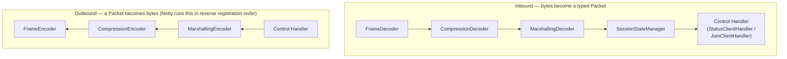

# The Protocol Pipeline

`protocol` talks to a Minecraft server through a Netty `ChannelPipeline` built from seven small,
single-purpose handlers instead of a couple of do-everything ones. This document walks through
what each stage does and why it's shaped this way. For the terse, authoritative version of these
decisions, see [AGENTS.md](../AGENTS.md#protocol-pipeline-architecture); this doc is the tour.

## The seven stages

Every stage does exactly one thing:

| Stage | Job |
|---|---|
| `FrameDecoder` / `FrameEncoder` | Strip/prepend the VarInt length prefix. Always the plain structure — never knows compression exists. |
| `CompressionDecoder` / `CompressionEncoder` | Apply the Data Length field + zlib once enabled — a `compressionThreshold` field, `-1` until Set Compression arrives. |
| `MarshallingDecoder` / `MarshallingEncoder` | Turn `[packet ID][bytes]` into a typed `Packet` and back. The decoder's behavior is state-dependent (see below); the encoder isn't. |
| `SessionStateManager` | Owns the connection's `ProtocolState`. Reacts to whatever implies a state or compression change. **Sends nothing.** |
| Control handler | Sends every reply the protocol needs. Holds no state of its own. |

Registering all seven in this one order produces the correct order in *both* directions, because
Netty walks outbound handlers in the reverse of their registration order — a packet the control
handler writes travels marshaller → compressor → framer → socket, the mirror of how inbound bytes
arrive.

## Walking through a join

Calling `MinecraftClient.observeJoin(host, port, username)` does nothing yet except register a
`ChannelInitializer` and start connecting. The interesting part starts once the socket is actually
up:

1. **`channelActive` fires** — this is the one moment with no packet to react to yet, so it's the
   only place a control handler acts without being told to. `JoinClientHandler.channelActive`
   sends `HandshakePacket`, then makes the *one* explicit cross-handler call in this whole design:
   `sessionState(ctx).transitionTo(ctx, LOGIN)` — because Handshake has no response at all, so
   nothing will trigger this transition on its own.
2. **Bytes come back.** `FrameDecoder` buffers until it has one complete frame.
   `CompressionDecoder` passes it through (still disabled). `MarshallingDecoder` reads the packet
   ID and asks whichever `PacketMarshaller` is *currently installed* — `LoginMarshaller`, because
   of the swap in step 1 — to decode it.
3. **`SessionStateManager` sees it first.** If it's `SetCompressionPacket`, it flips the
   compressor on right there — no send involved, no decision, just a mutation. If it's
   `LoginSuccessPacket`, it transitions to `CONFIGURATION` (swapping the marshaller again) *before*
   forwarding the packet on. Either way, it calls `ctx.fireChannelRead(packet)` unconditionally.
4. **The control handler reacts.** It never asks what state it's in to decide *what* to do —
   `LoginSuccessPacket` unambiguously means "send Login Acknowledged and Client Information,"
   regardless of state. It only queries `SessionStateManager.state()` for one thing: whether to
   keep resetting its own completion deadline.
5. **Repeat through Configuration, reach Play.** `KnownPacksPacket` gets echoed back empty;
   `FinishConfigurationPacket` gets acknowledged and (via `SessionStateManager`) flips the
   marshaller to `PlayMarshaller`.
6. **Completion.** A quiet gap (Login/Configuration — a genuine burst-then-pause) or a fixed
   window (Play — continuous traffic, no natural gap to wait for) completes the `CompletableFuture`
   and closes the channel.

## Why split it this far — three tiers, and a seam inside the middle one

1. **Marshal/unmarshal** — bytes ↔ typed `Packet`. Zero state, zero decisions.
2. **Connection mechanics** — stateful, but *zero-decision*: does replying require input from
   outside `protocol`? If not, it's mechanics. This tier splits further, along a real seam:
   - *Mutate* (`SessionStateManager`) — `SetCompressionPacket` needs no reply at all, just an
     internal flip. Sends nothing, ever.
   - *Send* (control handler) — `LoginSuccessPacket` needs both a mutation *and* a reply. Only
     this half ever calls `ctx.writeAndFlush`.
3. **Business logic** — an actual decision or preference (view distance, movement, respawn
   policy). Never belongs in `protocol` — that's `bot`'s job, driven by a deterministic per-tick
   loop with no LLM in it (see AGENTS.md's latency architecture). One acknowledged violation to
   watch: `ClientInformationPacket.defaults()` is hardcoded in the control handler today — tier-3
   content sitting in tier-2 code, tolerated only because nothing yet needs to vary it.

## Static structure, swappable delegates — not pipeline surgery

`CompressionDecoder`/`Encoder` and `MarshallingDecoder`/`Encoder` are *always* present in the
pipeline. What changes over a connection's life is an internal field — `compressionThreshold`, or
`MarshallingDecoder`'s active `PacketMarshaller` — set via a narrow setter `SessionStateManager`
calls on each transition, never Netty's `ChannelPipeline.replace()`/`addAfter()`. Three reasons:
the pipeline's shape is knowable by reading `MinecraftClient.addPipeline()` once, rather than
tracing every place that might mutate it at runtime; each handler with a swappable delegate is
trivially unit-testable in isolation; and it sidesteps real subtleties in `ByteToMessageDecoder`
around leftover buffered bytes when a decoder is replaced mid-stream. The rule for when you'd
actually need real pipeline surgery instead: a stage's fundamental *contract* would need to
differ, not just its behavior. Decompression is always "`ByteBuf` in, `ByteBuf` out"; marshalling
is always "packet ID + bytes → `Packet`" — neither stage here ever needs to change shape, only
behavior.

## One marshaller class per state, not one generic table

`HandshakeMarshaller`, `StatusMarshaller`, `LoginMarshaller`, `ConfigurationMarshaller`, and
`PlayMarshaller` are five small classes rather than one class parameterized by a `Map`. This isn't
about who tracks state — `SessionStateManager` owns that regardless — it's that a named class is
a discoverable home for "everything that can arrive during this state," matching how
[docs/protocol-spec.md](protocol-spec.md) is itself organized section-by-state.
`HandshakeMarshaller.decode()` throws unconditionally: nothing is ever clientbound during
Handshake, so an actual invocation would mean something genuinely anomalous happened, not a
missing case to quietly add.

## Everything unrecognized is logged, not swallowed

Every marshaller falls back to `UnknownPacket(id, rawBytes)` for anything not in its table, and
`SessionStateManager` logs that at WARN — once per distinct (state, packet ID) kind, since Play
alone can repeat the same unrecognized ID hundreds of times a second. Configuration's IDs were
reverse-engineered this exact way: decode as `Unknown`, log the hex, read it by hand, add a real
type once confirmed. See [protocol-spec.md § 3.4](protocol-spec.md) for the worked example, and
`PlayLoginPacket` for Play's first one — found by searching captured hex for the server's own
reported entity ID.

## Resource-exhaustion guards terminate, they don't degrade

An oversized frame, a compression bomb, or (once implemented) a nesting-depth violation all
terminate the connection outright rather than skip-and-continue — see
[protocol-spec.md § 8](protocol-spec.md) for the full reasoning, and
[AGENTS.md's no-fallbacks tenet](../AGENTS.md) for why that's a deliberate, general policy and not
specific to this pipeline.
